# Synap – Joomla Integration

## Project overview

This repository documents a proposed integration between **Joomla**, **RSForm!Pro**, **Stripe** and the **Synap examination platform**.

The aim is to let candidates purchase an examination on a Joomla website, receive a personal link to take the examination in Synap, and receive an email from Joomla when their result is available.

Joomla will manage the purchase, candidate communication and registration history. Synap will deliver and mark the examination.

This is a proposed workflow and technical plan. It is not a description of a completed integration. Exact Synap API endpoints, request/response fields, webhook authentication and attempt-link behaviour must be verified against the API access available to the Synap account before implementation.

## Systems and responsibilities

| System | Responsibility |
| --- | --- |
| Joomla | Orchestrates the workflow, stores registrations and results, and sends candidate emails. |
| RSForm!Pro | Collects candidate details and the selected examination language, and presents the purchase/retake form. |
| Stripe | Processes the payment and provides server-side confirmation of its status. |
| Synap | Manages candidates, examination attempts, random question selection, examination delivery and results. |
| Holopin | Issues a verifiable digital badge when a candidate passes. Joomla obtains and includes the individual claim link in the success email. |

The integration should keep the candidate-facing purchase and email experience on the Joomla website. Synap should be used as the examination platform, rather than as the system responsible for payment or candidate email communication.

## End-to-end workflow

The flowchart below shows the complete candidate journey, including the separate submission, proctoring-review and result-release stages. A submitted attempt is not necessarily a final result. If Synap flags an attempt for proctoring review, Joomla records the pending review, tells the candidate that their result will be sent within one day, and notifies the Joomla administrators. Joomla only processes a pass or fail after Synap releases the result. The retake route returns to the same purchase process: RSForm!Pro applies the retake price, while Synap receives a new registration for the selected language examination.

```mermaid
flowchart TD
    A["Candidate visits Joomla website"] --> B["RSForm!Pro: enter details and choose exam language"]
    B --> C{"Purchase type?"}
    C -->|"Initial purchase"| D["RSForm!Pro applies full fee"]
    C -->|"Retake purchase"| E["RSForm!Pro applies retake discount"]
    D --> F["Stripe processes payment"]
    E --> F
    F --> G{"Payment confirmed server-to-server?"}
    G -->|"No"| H["Do not allocate exam access"]
    G -->|"Yes"| I["Joomla creates registration and records language"]
    I --> J["Joomla selects the matching Synap exam and its configured user group"]
    J --> K["Joomla registers candidate with Synap; group membership generates a fresh attempt"]
    K --> L["Joomla stores Synap user and attempt details"]
    L --> M["Joomla emails candidate exam access instructions using the agreed password workflow"]
    M --> N["Candidate signs in to Synap and takes the exam"]
    N --> O["Synap notifies Joomla that the attempt has been submitted"]
    O --> P["Joomla retrieves the attempt from the Synap API"]
    P --> Q{"Does the attempt require proctoring review?"}
    Q -->|"No"| R["Wait for Synap to release the result"]
    Q -->|"Yes"| S["Joomla records a pending review and a 24-hour result deadline"]
    S --> T["Joomla emails candidate: proctoring review required; results within one day"]
    S --> U["Joomla notifies administrators that the attempt needs review"]
    U --> V["Administrator reviews the attempt in Synap"]
    V --> W["Synap finalises and releases the result"]
    R --> W
    W --> X["Synap notifies Joomla that the result has been released"]
    X --> Y["Joomla retrieves attempt and verifies resultsStatus is released"]
    Y --> Z["Joomla records final result and closes any pending review"]
    Z --> AA{"Passed?"}
    AA -->|"Yes"| AB["Joomla requests regular badge from Holopin"]
    AB --> AC["Joomla stores private Holopin claim link"]
    AC --> AD["Joomla sends congratulations email with claim link and social-sharing text"]
    Z --> AE["Joomla records pass in certification records"]
    AE --> AF{"Candidate consented to public listing?"}
    AF -->|"Yes"| AG["Publish public Joomla verification profile"]
    AF -->|"No"| AH["Keep record private; no public profile"]
    AG --> AI["Public can verify certification using permanent Joomla URL"]
    AA -->|"No"| AJ["Joomla sends failure email with retake discount"]
    AJ --> AK["Candidate returns to RSForm!Pro and purchases retake"]
    AK --> B
    AD --> AL["Candidate may claim and share Holopin badge"]
    AL --> AM["Holopin badge can link to Joomla verification profile"]
    AI --> AN["Joomla remains the authoritative certification record"]
    AM --> AN
```



**Important:** A retake is not a separate Synap product or examination. It is a new paid registration and a new attempt on the same language-specific Synap examination. Synap does not need to know whether the candidate paid the standard fee or a discounted retake fee. The Joomla verification page remains the authoritative record; Holopin is an optional, shareable credential.

## Examination languages

There are **six completely separate examinations in Synap**, one for each language. The candidate chooses their examination language in the RSForm!Pro form.

Joomla must use that submitted selection to choose the corresponding Synap examination. The language must be stored with the registration and used throughout the lifecycle of that purchase. It must not be inferred from the candidate's browser, Joomla's default language or email address.

The six Synap examination IDs will be configurable in Joomla. The actual IDs and language labels/codes will be added once supplied.

| Language | Synap examination |
| --- | --- |
| English | ex-en-j6  |
| German |  ex-de-j6|
| Spanish |  ex-es-j6|
| French | ex-fr-j6 |
| Italian  | ex-it-j6 |
| Dutch  | ex-nl-j6 |

The table deliberately uses placeholders until the Synap examination IDs are confirmed.

## Initial purchase workflow

1. The candidate opens the examination purchase form on the Joomla website.
2. RSForm!Pro collects the candidate's details and their choice of examination language.
3. The candidate pays the examination fee using Stripe.
4. Joomla waits for reliable server-side confirmation that the payment succeeded. A browser redirect or return to a thank-you page is not sufficient proof of payment.
5. Once payment is confirmed, Joomla creates a registration record and selects the Synap examination ID mapped to the chosen language.
6. Joomla uses the Synap API to find or create the candidate as required, and requests access to the selected examination.
7. Synap provides a candidate-specific examination link (subject to confirmation of the exact API operation and behaviour).
8. Joomla stores the relevant Synap identifiers and the access link, then sends the candidate an examination email containing the link and instructions.

A payment must not result in examination access being issued more than once. Payment notifications and the allocation process must therefore be safe to retry.

## Candidate password and account-access workflow

A candidate needs a Synap account password to sign in and open their candidate-specific examination link. The password workflow must be agreed before the production registration process and candidate emails are implemented.

Three approaches have been considered:

### Option 1: Generate a password and send it to the candidate

After confirmed payment, Joomla generates a strong random password and includes it with the candidate's examination link in an email.

This is straightforward to implement and avoids asking the candidate to choose another password during checkout. However, sending a working password by email is not ideal: the password may remain in mailboxes, forwarded messages or other email systems, and the candidate must retain it for future access. This should not be the preferred approach unless Synap cannot support a safer setup process and the security implications are explicitly accepted.

### Option 2: Ask the candidate to choose a password in RSForm!Pro

The candidate enters a password as part of the Joomla registration form. Joomla passes that password to Synap when creating the account.

This lets the candidate choose a password they can remember and avoids sending a working password by email. However, it means handling a password in the RSForm!Pro submission process. The implementation would have to ensure that the password is never retained in form submissions, email notifications, logs, exports or other stored submission data, and is transmitted securely to Synap. This adds avoidable security and data-handling risks to the purchase form.

### Option 3: Generate a password initially, then let the candidate set their own

After confirmed payment, Joomla generates a strong random password and uses it to create the Synap account. Joomla then obtains a password-setup or password-reset link and emails the candidate a link to choose their own Synap password. The candidate can subsequently use that password with the exam link and for future access.

This is the preferred approach, provided Synap supports it through an API operation or another supported mechanism. It avoids collecting a password in RSForm!Pro and avoids sending a working password to the candidate. The generated password is only an initial credential and should not be disclosed to the candidate.

### Question to ask Synap

Before choosing Option 3, confirm the supported password-setup workflow with Synap. The specific question is:

> When an external integration creates a new candidate using `POST /v3/user-registrations` and supplies an initial password, is there a v3 API endpoint or supported operation that allows the integration to generate or retrieve a one-time password-setup/password-reset URL for that user?
>
> Ideally, we want Joomla to send all candidate emails itself. Can the API return a setup URL without Synap sending its own password-reset email, so that Joomla can include the URL in its own email? If this is supported, please provide the exact endpoint, request and response fields, required permissions, URL expiry and whether the link is single-use. If it is not supported, what is the recommended way for an externally registered candidate to set their own password before accessing an exam?

Until Synap answers this question, the password workflow remains an open implementation decision. Do not add a password field to RSForm!Pro or finalise the candidate access email on the assumption that a password-setup endpoint exists.

Regardless of the chosen approach, passwords must not be stored in Joomla registration records, included in logs, or exposed in public pages. Synap remains responsible for authenticating the candidate; Joomla should retain only the identifiers and status information needed to coordinate registration and exam access.

## Examination attempts and random questions

Synap is configured to generate a random set of questions for each examination attempt.

There is one Synap examination per language. Joomla does not need separate Synap examinations for retakes and does not need to tell Synap whether a purchase is an initial purchase or a retake.

Every successful purchase results in a new examination attempt against the Synap examination corresponding to the language selected for that purchase. Synap is responsible for applying its random-question configuration to the attempt.

**Behaviour verified in the standalone API test:** registering a candidate through `POST /v3/user-registrations` with the appropriate `userGroups` relationship caused Synap to generate an attempt automatically. The returned attempt identified its registration method as `userGroup`. The integration should therefore use the group configured for the selected examination and retrieve the generated attempt for that candidate. The exact production user-group mapping for each of the six language examinations still needs to be configured and verified.

The test also confirmed that attempts can be listed with `GET /v3/attempts` using an `owner` filter, and retrieved individually with `GET /v3/attempts/{attemptId}`. The integration must verify that each paid registration produces one fresh attempt and that a retake does not reopen a previously completed attempt.

## Examination completion and results

An examination being submitted and its result being released are separate stages. Synap may need to complete marking, finalise the marks and/or complete a proctoring review before the result is released. Joomla must not treat a score or grade returned for a submitted attempt as final until the attempt reports `resultsStatus: released`.

The preferred notification mechanism is a Synap webhook to a dedicated Joomla endpoint. Live testing on 25 November 2026 confirmed two separate webhook subscriptions: `Exam Attempt Submitted` and `Exam Attempt Released`. The delivered payloads identify these as `exam.submitted` and `exam.released` in `meta.eventName`. The Synap webhook configuration supports HTTP Basic Authentication. The observed payload structures and receiver test are documented in [Verified Synap API and webhook findings](#verified-synap-api-and-webhook-findings). Delivery retry guarantees and the exact production authentication configuration should still be confirmed before launch.

### When an attempt is submitted

When Joomla receives a submission notification, it should:

1. Authenticate and validate the notification.
2. Identify the relevant registration and attempt using stable Synap identifiers, not just the candidate's email address.
3. Confirm that the event relates to an attempt known to Joomla.
4. Retrieve the current attempt from Synap using its attempt ID.
5. Check the attempt's completion, proctoring and result fields.
6. Record the submission timestamp and current status.
7. Avoid sending a pass/fail email, issuing a badge or offering a retake until the result has been released.

The standalone API test confirmed that a submitted attempt can have `isCompleted: true` and `examStatus: submitted` while its result is still pending. In the test, Synap returned `resultsStatus: pending` and `resultsMarkingStatus: readyToFinalise`. A provisional `score` and `grade` were also present, but these must not be treated as the final outcome.

### When proctoring review is required

Some submitted attempts require a human proctoring review. The test confirmed that Synap exposes this condition through fields including `proctorRequiresReview: true` and `proctorStatus: readyForReview`. A proctoring review is performed in Synap by an authorised administrator; Joomla records and coordinates the outstanding work but does not itself approve the proctoring session.

When the retrieved attempt requires review, Joomla should:

1. Create or update a pending proctoring-review record linked to the Joomla registration, Synap user and Synap attempt.
2. Record when the attempt was submitted and set a result-notification deadline one day (24 hours) after submission.
3. Send the candidate an acknowledgement email explaining that their examination has been submitted and requires a proctoring review. The email must say that they will be notified of their result within one day and that no further action is required from them unless contacted.
4. Notify the Joomla administrators that an examination requires proctoring review. The notification should identify the candidate, examination, submission time, Synap attempt and the deadline, and provide a link or reference that allows the administrator to open the attempt in Synap.
5. Show the review as pending in Joomla's administration area until Synap reports that the review has been completed and the result released.

The one-day period is the candidate-facing service commitment. Joomla should track the deadline so administrators can identify reviews that are approaching or have exceeded it. Notifications must be idempotent: duplicate webhook deliveries must not send repeated acknowledgement emails or create duplicate review tasks.

The review and result-release stages are distinct. In the test, approving the proctoring review changed the attempt to `proctorIsApproved: true` and `proctorStatus: passed`, and cleared `proctorRequiresReview`. The marks were then finalised, with `resultsStatus: finalised` and `resultsMarkingStatus: completed`. A subsequent release action changed `resultsStatus` to `released`, set `deferred.locked: false` and populated the `releasedBy` relationship. Joomla must wait for the release state, not merely the proctor approval or marking finalisation.

If no proctoring review is required, Joomla should still wait until Synap reports that the result has been released. A submission notification alone is never sufficient to trigger the pass/fail workflow.

### When the result is released

When Synap notifies Joomla that the result has been released, Joomla should:

1. Authenticate and validate the notification.
2. Retrieve the attempt from Synap and confirm that `resultsStatus` is exactly `released`.
3. Confirm that the attempt belongs to the expected Joomla registration and candidate.
4. Record the final completion date, score, grade and pass/fail outcome.
5. Mark the event as processed so duplicate deliveries cannot trigger duplicate actions.
6. Close any pending proctoring-review record.
7. Send the appropriate result email from Joomla and perform the relevant certification actions.

The test confirmed that the released attempt includes the final score and grade, `resultsStatus: released`, and a populated `releasedBy` relationship. Joomla should use the released attempt as the authoritative source for the outcome.

### Successful result

When the candidate passes, Joomla should initiate two additional actions: issue a Holopin badge and publish the candidate's certification in the public directory (subject to the candidate's directory-publication choice).

#### Issue a Holopin badge

Joomla uses the Holopin API to issue the appropriate regular (static) badge for the certification. The badge represents the achievement; it is not issued for a payment or merely for completing an examination. Only a final passing result should trigger badge issuance.

The proposed API flow is:

1. Joomla receives and validates the final passing result from Synap.
2. Joomla records the pass before attempting external actions.
3. Joomla calls Holopin's regular badge API for the configured badge/sticker ID, supplying the candidate's email address only if the API flow is intended to send an email from Holopin. The preferred flow is to omit the email so that Joomla remains responsible for all candidate communication.
4. Holopin returns a coupon identifier for a unique claim URL.
5. Joomla constructs/stores the claim URL using the documented format, `https://holopin.io/claim/[couponId]`.
6. Joomla includes the claim link in the success email.

The documented regular-badge API endpoint is `POST https://www.holopin.io/api/sticker/share?id=[stickerId]&apiKey=[apiKey]`. The API documentation describes an optional recipient email and a coupon ID that can be used to construct an individual claim URL. The exact request format, response handling, API key permissions and any metadata fields must be confirmed during implementation.

The Holopin API key and badge/sticker ID must be stored securely in Joomla configuration. Badge issuance must be idempotent: retries after a timeout or webhook redelivery must not accidentally issue multiple badges for the same certification achievement. Joomla should store the Holopin coupon ID, claim URL, badge/sticker ID, issuance status and timestamps.

The success email should contain:
- Confirmation that the candidate passed.
- The Holopin badge claim link.
- A short explanation of how to claim the badge.
- A suggested social-media message the candidate can copy or adapt to announce that they passed, with a link to their claimed badge or public verification profile when available.

Joomla should not publish the private claim URL in the public directory. It is an individual claim credential and belongs in the candidate's private success email. Once claimed, the candidate may share the public badge/profile URL provided by Holopin.

Holopin describes regular badges as static digital badges and documents social sharing of badges and badge boards. The integration should use the regular badge flow rather than the experimental custom-image endpoint unless a later requirement specifically needs per-recipient badge artwork.

#### Public certified-user directory

**Joomla's public verification page is the permanent, authoritative record of certification.** Holopin provides a portable digital badge that the candidate can claim and share, but it is supplementary evidence and is not the source of truth.

A third party should be able to verify a person's certification using a stable Joomla URL, whether or not the candidate has claimed their Holopin badge, still has access to their Holopin account, or chooses to share the badge. The Joomla verification page should remain available for as long as the certification remains valid, subject to the site's published retention and certification policies.

Joomla should also provide a public directory of people who have passed the examination, modelled on the [Joomla Certified User Directory](https://certification.joomla.org/certified-user-directory).

The directory is a Joomla feature and its data should come from Joomla's own verified examination records, not from a list of people who have claimed their Holopin badge. Passing the examination is the evidence for certification; claiming a Holopin badge is optional and must not determine whether someone appears in the directory.

The public directory should allow visitors to:
- Browse and search certified candidates.
- See the certification or examination achieved.
- See the date the candidate passed or was certified.
- Open an individual public profile or verification page at a stable, permanent Joomla URL.
- Verify that a named person has a recorded pass for the stated certification, independently of Holopin.

The exact public fields and directory-publication rules must be agreed before implementation. Recommended default: ask candidates for explicit consent to appear in the public directory during registration, and publish only the fields they have agreed to make public. For example, this might include their display name, certification title and date achieved. Email addresses, payment details, Synap identifiers, examination scores, internal registration references and Holopin claim URLs must never be exposed publicly.

Each public profile should have a stable URL that can be shared independently of Holopin. This Joomla page is the canonical verification reference and should show the current certification status and enough information for a third party to verify the claim. The Holopin badge and its public profile may link back to this Joomla page, but must not replace it. If a certification is revoked or corrected, the directory entry must be updated accordingly.

The directory should support pagination and search/filtering as its population grows. Search-engine indexing should be an explicit product/privacy decision, not an accidental consequence of making the pages public.

### Unsuccessful result

When the candidate fails and Synap has released the result, Joomla sends a failure email. This email includes information about purchasing a retake and the applicable discount code. If the attempt previously required proctoring review, this is the result email promised in the pending-review acknowledgement.

The result and email status should be stored so that an email can be retried after a delivery problem without changing or reprocessing the examination result.

## Retakes and discounted fees

Retakes are a **Joomla and RSForm!Pro pricing matter only**. Synap does not need to know that a candidate is taking a retake.

The retake process is:

1. The candidate fails an attempt.
2. Joomla sends the failure email, including a discount code or retake purchase instructions.
3. The candidate returns to the Joomla website and purchases a retake through RSForm!Pro.
4. The candidate selects the language of the examination they want to take.
5. RSForm!Pro applies the retake price/discount and Stripe processes the payment.
6. After confirmed payment, Joomla creates a new registration and requests a new attempt against the Synap examination for the language selected.
7. Joomla sends a new candidate-specific examination link.

The retake discount must be validated and applied server-side. A price or discount amount supplied only by the browser must never be trusted.

Joomla may record whether a purchase was an initial purchase or a discounted retake for financial and administrative reporting. That information must not alter the Synap API request or examination allocation behaviour.

The language selected on the retake purchase determines which of the six Synap examinations is allocated. If the business rules later require retakes to be restricted to the language of the failed attempt, that restriction should be enforced in Joomla/RSForm!Pro, not in Synap.

## Joomla data and administration

Joomla should retain a record of each paid registration and each examination attempt. A candidate may have multiple registrations over time, and previous registrations and results must not be overwritten by a retake.

At a minimum, the data model should capture:

### Registration

- Joomla registration ID
- Candidate name and email address
- Selected examination language
- RSForm!Pro submission reference
- Stripe payment/session/transaction reference
- Payment status and amount/currency
- Purchase type for reporting (initial or retake, if available)
- Registration status and timestamps

### Examination attempt

- Related Joomla registration ID
- Synap candidate/user ID
- Synap examination ID
- Synap attempt ID or other stable attempt reference
- Candidate-specific examination link, if appropriate to retain
- Attempt status, submission timestamp and result-release status/timestamp
- Proctoring enabled/status, whether review is required, approval status and review timestamp
- Pending-review status, notification timestamps and 24-hour result-notification deadline
- Score and grade, where supplied (treated as provisional until the result is released)
- Final pass/fail result
- Result-email status and timestamp
- Holopin badge/sticker ID
- Holopin coupon ID and private claim URL
- Holopin issuance status and timestamp
- Public-directory consent/status and publication timestamp
- Public profile URL or directory record ID

### Webhook/event processing

- Provider event ID, where supplied
- Event type (submission or result release)
- Related registration/attempt reference
- Received and processed timestamps
- Processing status and diagnostic information
- Pending proctoring-review notification state, to prevent duplicate candidate/admin notifications

An administrator view should make it possible to find a candidate and see their purchases, payment status, selected language, Synap examination/attempt references, result and email status. Resending an email should not create another examination attempt.

## Reliability and security requirements

- **Payment verification:** Only a verified server-to-server Stripe payment confirmation may trigger examination allocation.
- **Webhook authentication:** Validate Synap webhook requests using the authentication mechanism documented for the enabled Synap API version. Do not trust an unauthenticated POST.
- **Idempotency:** Repeated Stripe or Synap notifications must not create duplicate registrations, attempts or emails.
- **Retry handling:** If Synap is unavailable after payment, retain the paid registration as pending allocation and retry safely. The candidate must not have to pay again.
- **Email handling:** Save the result before sending email. Record delivery attempts and allow an administrator to retry email delivery independently.
- **Proctoring review:** When a submitted attempt requires review, notify the candidate that results will be provided within one day, notify Joomla administrators, and record a 24-hour deadline. Do not send a pass/fail email or issue a badge until Synap reports that the result has been released.
- **Review notification idempotency:** Duplicate submission webhooks must not create duplicate pending-review records or send duplicate candidate acknowledgement/admin notifications.
- **Result release:** Treat submission, proctor approval, marking finalisation and result release as distinct states. Only process the final outcome when the retrieved attempt reports `resultsStatus: released`.
- **Credentials:** Keep Synap and Stripe secrets on the server, outside public assets and source control. Use least-privilege credentials where supported.
- **Candidate passwords:** Prefer a Synap-supported one-time password-setup flow. Do not collect candidate passwords in RSForm!Pro unless the submission storage, notifications, logs and exports can be proven not to retain them. Never email a working password as the default approach.
- **Data protection:** Store only the candidate and examination data needed for the service, restrict administrator access and define appropriate retention periods. Obtain and record explicit consent before publishing personal details in the public certified-user directory; provide a process for correcting or removing public profile information where appropriate.
- **Public/private separation:** Never expose email addresses, payment data, internal identifiers, examination scores or Holopin claim URLs in public directory pages or public APIs.
- **Holopin issuance:** Issue a badge only for a final passing result, store the returned coupon/claim reference securely, and prevent duplicate issuance when events are retried.
- **Logging:** Log integration failures and useful reference IDs without exposing API tokens, payment credentials or unnecessary personal data.

## Proposed implementation stages

1. **Verify Synap access and API capabilities.** Confirm the API version, authentication, account permissions and availability of the required user, examination, attempt, candidate-link and webhook operations.
2. **Build a standalone API test.** Authenticate, retrieve the six examinations, find or create a test candidate, create a fresh attempt and obtain its candidate-specific link.
3. **Verify submission and result-release notifications.** Configure the `Exam Attempt Submitted` and `Exam Attempt Released` webhooks with HTTP Basic Authentication. The event names and payload shapes have been verified in live tests; production delivery, retry behaviour and end-to-end handling must still be tested.
4. **Implement the Joomla integration.** Add configuration for the six language-to-examination mappings, registration/attempt storage, API service and webhook endpoint.
5. **Integrate RSForm!Pro and Stripe.** Connect confirmed payment events to registration and attempt allocation. Keep initial and retake pricing in the form/payment workflow.
6. **Integrate Holopin.** Configure the regular badge/sticker ID and API credentials, issue a badge after a final pass, and verify that Joomla receives and stores the unique claim URL.
7. **Implement Joomla emails.** Add access, congratulations and failure/retake templates, with language-aware content as required. Include the Holopin claim link and suggested social-sharing text in the success email.
8. **Build the public certified-user directory.** Add candidate consent, searchable public listings and individual verification pages using Joomla's verified pass records.
9. **Add administration and recovery tools.** Provide registration/attempt views, a pending-proctoring-review queue with 24-hour deadlines, administrator notifications, badge issuance and directory-publication status, plus safe email/allocation/badge retries.
10. **Test end to end.** Cover each language, successful and failed payments, pass and fail results, retake purchases, duplicate webhooks, duplicate badge prevention, directory consent, email failures and Synap/Holopin API outages.

## Open questions to resolve before implementation

- Which six languages are offered, and what are their corresponding Synap examination IDs?
- Does the Synap account have access to the required API version, candidate management, attempt creation and webhooks?
- Which exact API operation creates a fresh attempt and returns a new candidate-specific examination link?
- What is the supported password-setup process for a candidate created through the API? Can the v3 API generate or return a one-time password-setup/reset URL without Synap sending its own email, so Joomla can send the link? What are the endpoint, permissions, expiry and single-use rules?
- Does Synap apply the random-question configuration independently to every attempt created through the API?
- What are Synap's webhook retry policy, timeout expectations and delivery guarantees? Are there any additional recommended controls beyond HTTP Basic Authentication?
- Does Synap always send a submission notification before a result-release notification, including when no proctoring review is required?
- Which Synap administrator roles and actions are required to review a proctoring flag, finalise marks and release results?
- Which RSForm!Pro payment-confirmation hook/event is appropriate for the installed version and Stripe integration?
- Should retake eligibility be restricted to the language of the failed attempt, or may the candidate choose any of the six languages when purchasing again?
- Should candidate emails be available in all six languages?
- What is the Holopin organization badge/sticker ID to issue for a successful certification?
- Should all successful candidates be listed publicly, or should directory publication be opt-in with explicit consent? Which profile fields may be shown?
- Should the directory be indexed by search engines, and should candidates be able to request a correction or removal?
- Should the public directory show the Holopin badge/profile link once claimed, in addition to Joomla's own verification page? The Joomla page remains authoritative regardless.

## Scope boundary

This project integrates Joomla with RSForm!Pro, Stripe, Synap and Holopin. It does not implement examination content, question randomisation or marking; those remain Synap responsibilities. Stripe processes payments, RSForm!Pro manages the purchase form, Holopin issues the digital badge, and Joomla coordinates the workflow, emails and public certification directory.


## Verified Synap API and webhook findings

The following findings were verified against the live Synap v3 API and webhook configuration during standalone testing on 25 November 2026. They are observations from the test account and should be rechecked against the production portal configuration before launch.

### API access and candidate registration

- The API base used for testing was `https://api.synap.ac/v3`.
- A personal access token was accepted using the `Authorization: Bearer` header and the `Accept: application/vnd.api+json` header.
- `GET /portals/current` and `GET /exam-v-2s` returned successfully.
- `POST /user-registrations` created a candidate when supplied with the required name, email address, password, locale, external ID and user-group relationship. The optional `registrationSource` attribute was omitted; Synap support confirmed that it defaults to generated.
- The registration request used `welcomeEmailDisabled: true` so candidate communication remains under Joomla's control.
- The registration response did not consistently include a `generatedAttempt` relationship, even though an attempt was created. Do not rely on that relationship being present.
- Adding the candidate to the relevant student user group caused Synap to generate an attempt automatically. The attempt's registration method was `userGroup`.
- Attempts can be located with `GET /attempts?filter={"owner":"<synapUserId>"}` and retrieved individually with `GET /attempts/{attemptId}`. An unfiltered `GET /attempts?filter={}` returned a validation error because the owner filter was required in this test.
- The candidate-specific exam URL observed and successfully opened in a browser was `https://<portal-host>/exam-hall/{attemptId}`. The portal host and attempt ID must be taken from the configured account and API response; do not hard-code the test portal or attempt.
- The password policy rejected a test password that did not include the required character classes. The observed policy required at least eight characters, including uppercase, lowercase and a digit. Confirm the production account's policy rather than relying on this test value.

### Webhook configuration and receiver

Two separate webhook subscriptions were created in Synap because the configuration allowed one event per webhook:

| Synap webhook event selection | Delivered `meta.eventName` |
| --- | --- |
| Exam Attempt Submitted | `exam.submitted` |
| Exam Attempt Released | `exam.released` |

Both subscriptions can point to the same endpoint. The test endpoint used HTTPS and HTTP Basic Authentication. The Synap webhook configuration exposes a Basic authentication option; the username and password must match the values configured on the receiving server.

A small PHP receiver was deployed for testing. It:

- Requires valid HTTP Basic Authentication and returns HTTP 401 when credentials are missing or incorrect.
- Accepts POST requests and returns HTTP 405 for other methods.
- Reads the raw request body and appends it to a JSON Lines log.
- Stores the log and credential file outside the public web directory, with restrictive file permissions.
- Does not write the Basic Authentication password to the request log.

The receiver was tested manually: an unauthenticated GET returned HTTP 401, an authenticated JSON POST returned HTTP 200 with `{"received":true}`, and the test payload was confirmed in the private log. A deliberately incorrect password in the Synap configuration caused a 401 delivery failure; correcting the password allowed delivery. This confirms the authentication arrangement, but the temporary test receiver is not itself the Joomla production webhook implementation.

Do not commit webhook credentials, API tokens, raw production payloads, candidate passwords or private log files to this repository. Production logging should redact credentials and avoid retaining unnecessary candidate or examination data.

### Observed webhook payloads

Both event payloads contained a `meta` object with a timestamp and event name. The event name is not at the top level.

For `exam.submitted`, the observed payload had these top-level fields:

```text
user, portal, meta, attempt, test, id, timeStarted,
timeCompleted, timeSpentInMs, exam
```

The attempt ID was available at the top level as `id`. The submitted event included a full attempt object. In the tested attempt, the candidate had submitted the exam, but the result was initially pending and marking was ready to finalise. A provisional score and grade were present. Those values must not be treated as final.

For `exam.released`, the observed payload had these top-level fields:

```text
user, portal, meta, attempt, test, exam
```

The attempt ID was nested at `attempt.id`, not at the top level. The final result fields were nested within `attempt`, including:

- `attempt.results.status` — observed as `released`.
- `attempt.results.markingStatus` — observed as `completed`.
- `attempt.score` and `attempt.scoreFrac`.
- `attempt.gradeOutcome`.
- `attempt.grade.isPass` and `attempt.grade.label`.
- `attempt.audit.releasedAt`.

The two event payloads are therefore not structurally identical. Joomla's handler must branch on `meta.eventName` and extract the attempt ID from the appropriate location:

| Event | Attempt ID location |
| --- | --- |
| `exam.submitted` | Top-level `id` |
| `exam.released` | `attempt.id` |

The event names and field paths above are based on actual deliveries from the test account. Joomla should still validate the payload shape defensively and retrieve the attempt through `GET /attempts/{attemptId}` before changing the certification record, sending result emails or issuing a badge. The webhook is a notification, not the authoritative database for Joomla's certification workflow.

### Submission, proctoring and release are separate states

The live test confirmed that submission, proctor review, marking finalisation and result release are distinct stages.

For a submitted attempt that requires proctoring review, the API initially returned fields including:

- `examStatus: submitted`
- `resultsStatus: pending`
- `resultsMarkingStatus: readyToFinalise`
- `proctorRequiresReview: true`
- `proctorStatus: readyForReview`

A provisional score and grade were also present. These are not a final result.

After an administrator approved the proctoring review, the attempt showed `proctorIsApproved: true`, `proctorStatus: passed` and `proctorRequiresReview: false`. Marking was then finalised, with `resultsStatus: finalised` and `resultsMarkingStatus: completed`. Only after a separate release action did the attempt report `resultsStatus: released`; the deferred lock was cleared and the release audit information was populated.

A separate test attempt was automatically approved. Its release webhook contained `attempt.proctorStatus: autoApproved`, `attempt.results.status: released`, a final score and a final grade. This demonstrates that not every attempt requires a manual review.

The Joomla implementation must therefore:

1. On `exam.submitted`, extract the top-level `id`, retrieve the attempt from Synap and inspect its current proctoring and result states.
2. If review is required, record the pending review, notify the candidate that their result will be provided within one day (24 hours), and notify Joomla administrators. Do not send a pass/fail email.
3. On `exam.released`, extract `attempt.id`, retrieve the attempt again and confirm that the API reports `resultsStatus: released`.
4. Only after that confirmation, record the final result and perform the pass/fail email, Holopin and certification-directory actions.
5. Make processing idempotent so duplicate deliveries cannot create duplicate review notifications, result emails or badges.

The webhook event's own `attempt.results.status` or `attempt.grade` can be useful for diagnostics, but the retrieved API attempt should be used as the final check before taking consequential action.

### Remaining verification

The live tests establish that the two event types can be delivered to one Basic-Authenticated HTTPS receiver and that their payloads expose the fields described above. The following still need confirmation before production:

- Synap's retry policy, delivery timeout and failure/replay controls.
- Whether webhook deliveries include a unique event ID or other deduplication identifier in addition to `meta.timestamp`.
- Whether the production portal uses the same payload fields and event names.
- The correct production user-group and examination mapping for all six languages.
- The supported candidate password-setup/reset-link API operation, if available.
- Behaviour under duplicate, delayed and out-of-order webhook deliveries.
